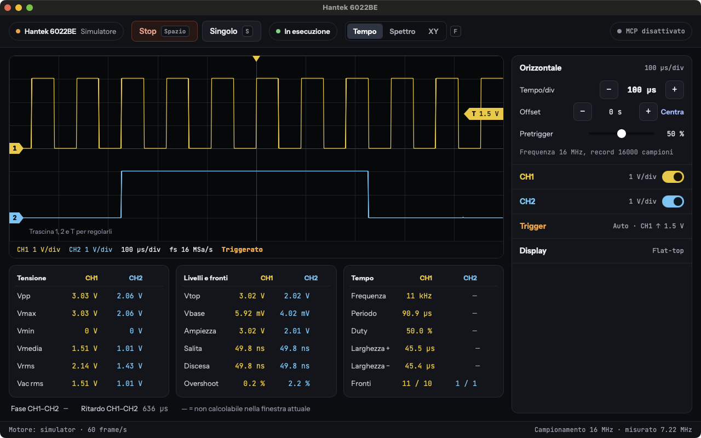
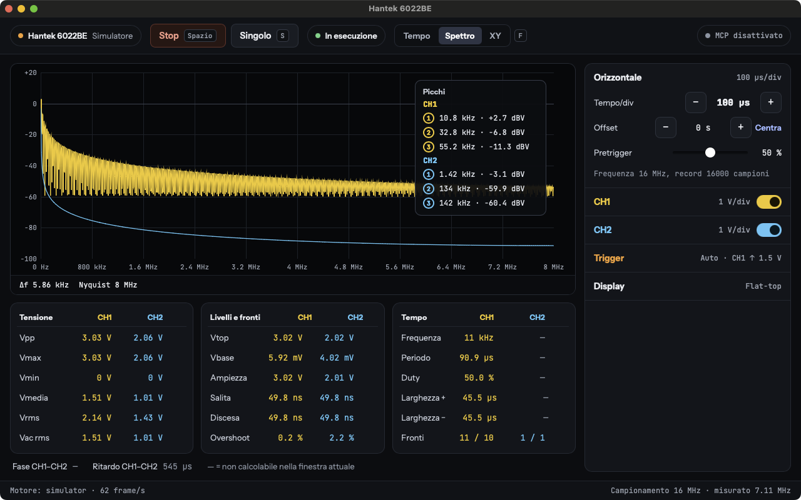
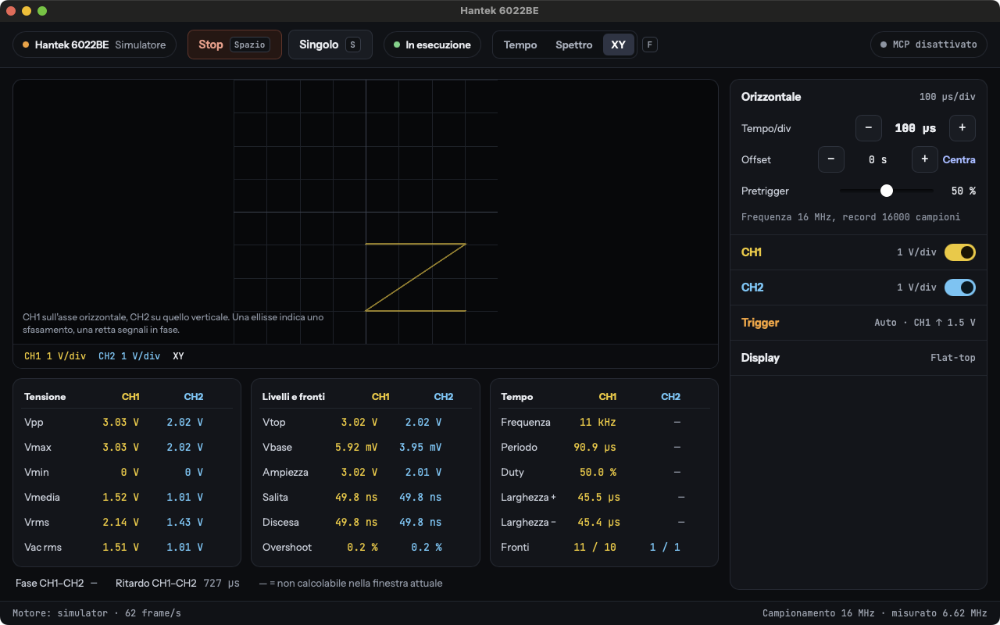

# Hantek Oscilloscope

Open-source software for Hantek USB oscilloscopes. It currently supports the Hantek 6022BE.
It runs on macOS, Windows and Linux.

Project website: **[adapt-to-it.github.io/hantek-oscilloscope](https://adapt-to-it.github.io/hantek-oscilloscope/)**

> [!WARNING]
> **Windows and Linux are only partly tested.** The author develops and tests the software
> on macOS with a real Hantek 6022BE. On Windows the desktop app works with the device; the CLI and
> the MCP server have not been tried there yet. On Linux ARM64 the CLI and the MCP server work with
> the device; the desktop app has not been tried there yet. On Linux x64 the CI only checks that the
> code compiles and that the unit tests pass. If you try them, report the result with the
> [platform test report](https://github.com/adapt-to-it/hantek-oscilloscope/issues/new?template=6-platform-report.yml).

It is a modern alternative to the original Hantek software and to OpenHantek. A single Rust
engine drives the device. A desktop app, a command-line tool, an MCP server for AI agents and a
Python API all use that engine.



## Features

- **Acquisition**: two channels, 8 bit, up to 48 MS/s. Continuous streaming, block capture and
  roll mode for slow time bases.
- **Software trigger**: edge, pulse width, runt, window, slope, timeout, two-channel pattern,
  logical AND/OR and A → B sequence. Auto, normal and single modes.
- **Measurements**: Vpp, Vmax, Vmin, mean, RMS, frequency, period, duty cycle, rise and fall
  time, overshoot, phase between channels, with statistics.
- **Analysis**: cursors, FFT with Hann, Blackman-Harris and flat-top windows, spectrogram, math
  channels, filters, XY mode, color persistence, sin(x)/x interpolation.
- **Protocol decoders**: UART with automatic baud-rate detection, I2C, CAN, 1-Wire, PWM and servo,
  IR (NEC, RC5), Manchester. **Not tested yet with real signals.**
- **Pattern recognition**: signal classification, waveform search, packet segmentation.
  **Not tested yet with real signals.**
- **Recording and export**: CSV, NumPy `.npy`, WAV, VCD.
- **Automation**: MCP server over streamable HTTP, binary WebSocket for Python and numpy.
- **Interface** in English, Italian, French and Spanish. Press `i` to show an explanation of
  any control.

| Spectrum | XY mode |
|---|---|
|  |  |

## Supported devices

| Device | Status |
|---|---|
| Hantek 6022BE | Supported |
| Hantek 6022BL | Planned |

The software loads its own firmware into the device RAM at every connection. The device keeps no
firmware, so unplugging it restores the original state.

## Platforms

| OS | Status |
|---|---|
| macOS (Apple Silicon and Intel) | Tested with the device |
| Windows | Desktop app tested with the device. CLI and MCP server not tested |
| Linux ARM64 | CLI and MCP server tested with the device. Desktop app not tested |
| Linux x64 | **Not tested.** Compiles and passes unit tests in CI only |

The USB layer uses [nusb](https://github.com/kevinmehall/nusb) and does not depend on libusb.

## Install

Download the installer for your system from the
[Releases](https://github.com/adapt-to-it/hantek-oscilloscope/releases) page.

| OS | File |
|---|---|
| macOS | `.dmg`, universal build for Apple Silicon and Intel |
| Windows x64 | `.msi` or `-setup.exe` |
| Windows ARM64 | `arm64-setup.exe` |
| Linux x64 and ARM64 | `.deb`, `.rpm` or `.AppImage` |

Each release also contains the `h6022` command-line tool for every platform.

### macOS

The app and the `.dmg` are signed with a Developer ID certificate and notarized by Apple.
Open the `.dmg` and drag the app to **Applications**.

### Windows

Windows needs the WinUSB driver for the oscilloscope. You install it once with
[Zadig](https://zadig.akeo.ie):

1. Connect the oscilloscope.
2. In Zadig, choose **Options → List All Devices**.
3. Select the device with ID `04B4 6022`, choose **WinUSB** and click **Replace Driver**.
4. Start the app. It loads the firmware, and the device reconnects with ID `04B5 6022`.
5. In Zadig, select the device `04B5 6022` and install **WinUSB** again.

The original Hantek software stops working while WinUSB is installed. To restore it, reinstall
the Hantek driver from Device Manager.

### Linux

The `.deb` and `.rpm` packages install a udev rule that gives the local user access to the
device. With the `.AppImage` or the CLI, install the rule by hand:

```bash
sudo cp packaging/linux/60-hantek-oscilloscope.rules /etc/udev/rules.d/
```

```bash
sudo udevadm control --reload-rules && sudo udevadm trigger
```

## Build from source

Requirements: Rust 1.88 or later, Node.js 20 or later. On Linux, also the WebKitGTK
development packages:

```bash
sudo apt-get install libwebkit2gtk-4.1-dev libgtk-3-dev libayatana-appindicator3-dev librsvg2-dev patchelf
```

```bash
cd ui && npm install && cd ..
```

To run the desktop app in development mode, from the repository root:

```bash
ui/node_modules/.bin/tauri dev
```

To build the installable package:

```bash
ui/node_modules/.bin/tauri build
```

To build and use the command-line tool:

```bash
cargo run --release -p h6022-cli -- info
```

The CLI offers the `info`, `capture`, `bench`, `eeprom`, `measure` and `serve` commands.

## MCP server

The app and `h6022 serve` start an MCP server on `127.0.0.1`. An AI agent can configure the
oscilloscope, capture, measure, decode and record. The available tools are `device_status`,
`get_config`, `set_config`, `run`, `stop`, `capture`, `snapshot`, `measure`, `spectrum`,
`decode`, `analyze_signal`, `classify_signal`, `find_pattern`, `find_packets`,
`start_recording`, `stop_recording` and `export_logic`.

## Python

`python/h6022.py` receives the samples over WebSocket as numpy arrays. See
`python/example_plot.py`.

## Repository layout

```
crates/
  h6022-usb      firmware loading, vendor commands, EEPROM, bulk streaming
  h6022-core     trigger, time base, auto/normal/single/roll modes, simulator
  h6022-dsp      measurements, FFT, filters, math channels
  h6022-decode   serial decoders, pulse analysis, pattern search
  h6022-record   recording to CSV, NumPy, WAV
  h6022-server   MCP and WebSocket server
  h6022-view     display logic shared by the views
  h6022-cli      command-line tool
  h6022-app      desktop app (Tauri)
ui/              Svelte interface
firmware/        FX2LP firmware (C, SDCC)
python/          Python client
```

## Issues and discussions

Choose the channel that matches your request. Each one has a form that asks for the details we
need.

### Issues: confirmed problems and concrete requests

| Category | Use it when | Label |
|---|---|---|
| [Bug report](https://github.com/adapt-to-it/hantek-oscilloscope/issues/new?template=1-bug.yml) | A feature gives a wrong result or behaves unexpectedly | `bug` |
| [Crash or freeze](https://github.com/adapt-to-it/hantek-oscilloscope/issues/new?template=2-crash.yml) | The app or the CLI closes, freezes or loses the device | `crash` |
| [Feature request](https://github.com/adapt-to-it/hantek-oscilloscope/issues/new?template=3-feature.yml) | You want a new function or an improvement | `enhancement` |
| [Protocol decoder request](https://github.com/adapt-to-it/hantek-oscilloscope/issues/new?template=4-decoder.yml) | You want a new serial decoder or a decoder option | `decoder` |
| [New device support](https://github.com/adapt-to-it/hantek-oscilloscope/issues/new?template=5-new-device.yml) | You want support for another Hantek model | `device-support` |
| [Platform test report](https://github.com/adapt-to-it/hantek-oscilloscope/issues/new?template=6-platform-report.yml) | You tried the software on Windows, Linux or a new macOS version | `platform-report` |
| [Documentation or translation](https://github.com/adapt-to-it/hantek-oscilloscope/issues/new?template=7-docs.yml) | A text, an explanation or a translation is wrong or missing | `documentation` |

Before you open an issue, search the
[existing issues](https://github.com/adapt-to-it/hantek-oscilloscope/issues?q=is%3Aissue). If
one already describes your problem, add your details there.

### Discussions: questions, ideas and projects

| Category | Use it when |
|---|---|
| [Q&A](https://github.com/adapt-to-it/hantek-oscilloscope/discussions/categories/q-a) | You need help with installation, drivers, settings or measurements |
| [Ideas](https://github.com/adapt-to-it/hantek-oscilloscope/discussions/categories/ideas) | You have an idea that is not yet a concrete feature request |
| [Show and tell](https://github.com/adapt-to-it/hantek-oscilloscope/discussions/categories/show-and-tell) | You want to share a project, a measurement, a script or a hardware mod |
| [Polls](https://github.com/adapt-to-it/hantek-oscilloscope/discussions/categories/polls) | The maintainers ask the community to choose between options |
| [Announcements](https://github.com/adapt-to-it/hantek-oscilloscope/discussions/categories/announcements) | The maintainers publish releases and news |

### Security

Report vulnerabilities privately through a
[security advisory](https://github.com/adapt-to-it/hantek-oscilloscope/security/advisories/new).
Do not open a public issue.

### How we handle requests

1. Every new issue receives the `needs-triage` label.
2. A maintainer reproduces the problem and replaces the label with `confirmed`, or with
   `needs-info` if details are missing. An issue in `needs-info` for 30 days without an answer
   is closed.
3. A request that the hardware cannot satisfy receives `hardware-limit` and is closed with an
   explanation. The 6022BE has 2 analog channels, 8 bit, 20 MHz and no hardware trigger.
4. Labels `platform: windows`, `platform: linux` and `platform: macos` mark problems that occur
   on one system only.
5. Issues with `good first issue` or `help wanted` are open to contributors.

## Releases

The workflows do not run on every push. GitHub Actions runs only when you publish a release.
To publish one, run this command from an up-to-date `main` branch:

```bash
scripts/release.sh 0.2.0
```

The script updates the version in `Cargo.toml`, `tauri.conf.json` and `ui/package.json`,
commits, creates the `v0.2.0` tag and pushes it. The tag starts the Release workflow:

1. It checks that the tag matches the version in `tauri.conf.json`.
2. It runs the tests on macOS, Windows and Linux. If one fails, the release stops.
3. It builds the installers and the CLI and attaches them to a GitHub Release.

To run only the tests without a release, open **Actions → CI → Run workflow**. A version with a
suffix, such as `0.2.0-beta.1`, becomes a pre-release.

The macOS build is ad-hoc signed by default. To sign it with a Developer ID certificate and
notarize the app and the `.dmg`, add these repository secrets: `APPLE_CERTIFICATE` (base64 `.p12`),
`APPLE_CERTIFICATE_PASSWORD`, `APPLE_SIGNING_IDENTITY`, `APPLE_ID`, `APPLE_PASSWORD`
(app-specific password) and `APPLE_TEAM_ID`.

## License

The Rust code and the interface are licensed under either of [MIT](LICENSE-MIT) or
[Apache-2.0](LICENSE-APACHE), at your option.

The firmware in `firmware/` derives from
[Ho-Ro/Hantek6022API](https://github.com/Ho-Ro/Hantek6022API) and
[fx2lib](https://github.com/djmuhlestein/fx2lib), and keeps its LGPL-2.1-or-later license.
See [firmware/README.md](firmware/README.md).

## Disclaimer

This project is not affiliated with or endorsed by Hantek. Hantek is a trademark of its owner.
